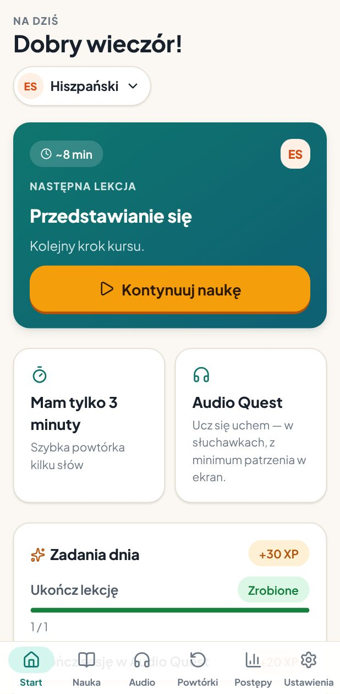
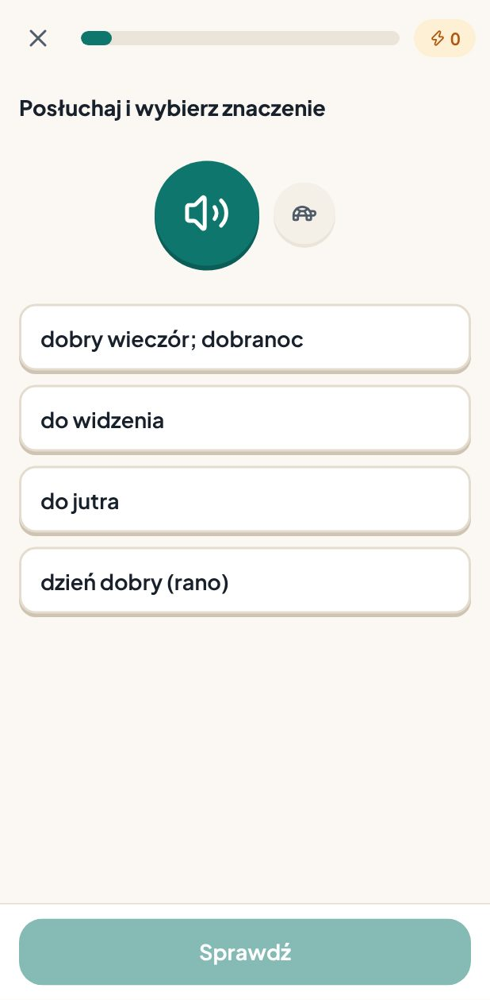
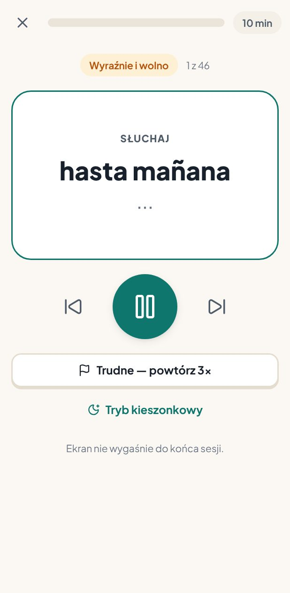
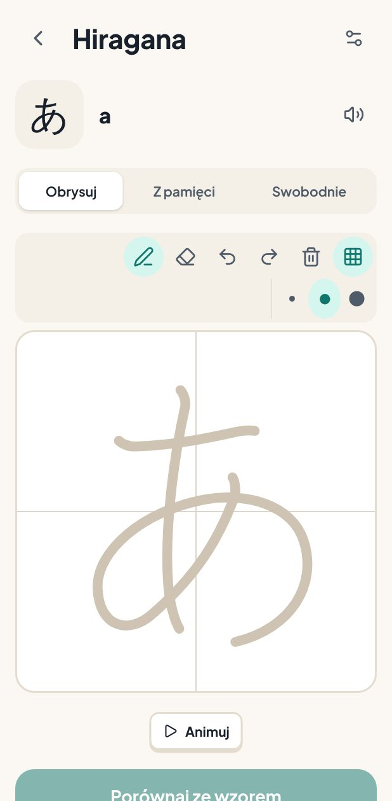
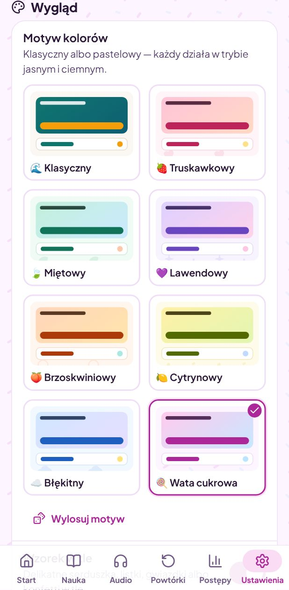
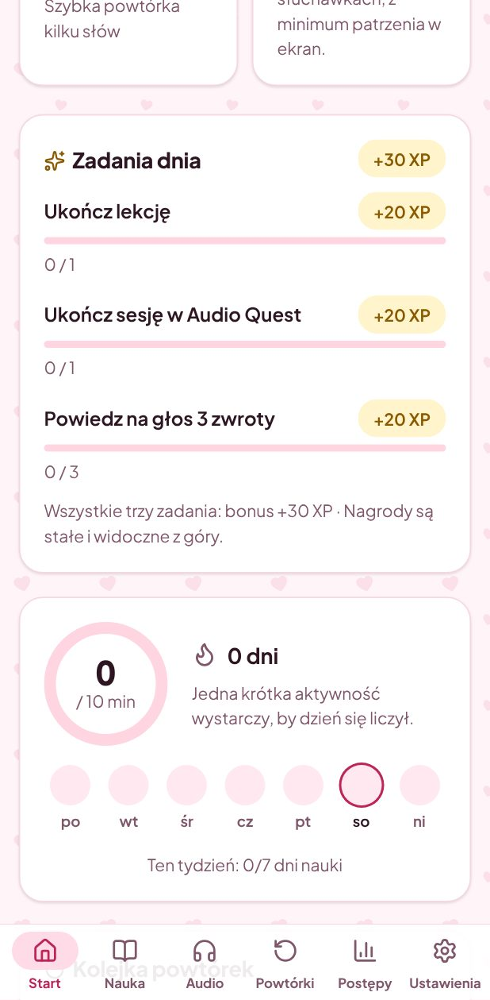
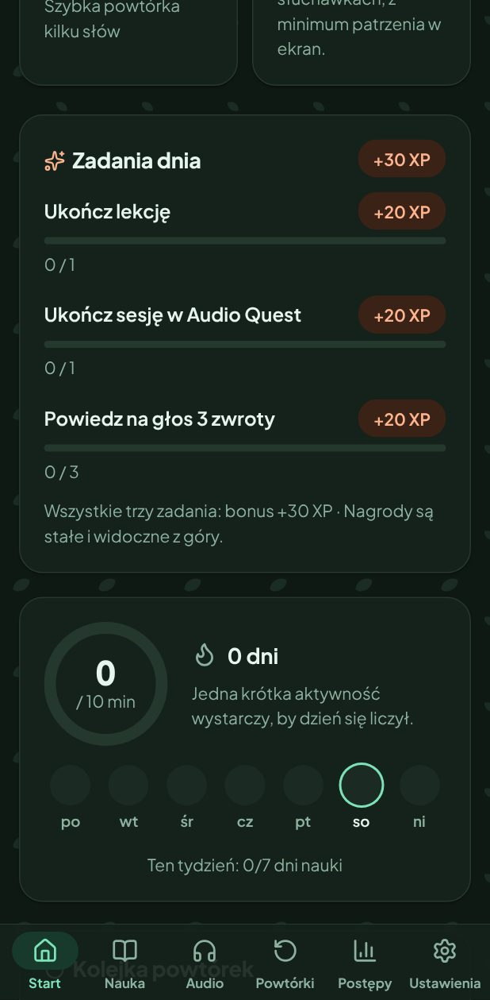

# Polyglot Quest

Mobile-first, audio-first language learning for Polish speakers: **Spanish, German and
Japanese from zero to A2, plus a first B1 unit**. One codebase runs in the browser (installable PWA, works offline) and as
an Android app (Capacitor). No account, no ads, no paid APIs: progress stays on the device.

> **Jak zacząć (PL):** otwórz **[aplikację w przeglądarce](https://livexxpl.github.io/Youlllearn/)**
> na telefonie, tablecie albo komputerze i dodaj ją do ekranu głównego, albo pobierz
> **[aplikację na Androida (APK)](https://github.com/LivexxPL/Youlllearn/releases/download/android-latest/polyglot-quest.apk)**.
> Instrukcja krok po kroku: **[INSTALACJA.md](INSTALACJA.md)**.

| Aplikacja w przeglądarce | Aplikacja na Androida (APK) |
| :-: | :-: |
|  |  |

<p>
  
  
  
  
</p>

<p>
  
  
  
</p>

## Status

| Area | State |
| --- | --- |
| Web app / PWA | ✅ Builds, runs offline, tested on phone/tablet/desktop viewports (light and dark) |
| Courses | ✅ 33 Spanish, 34 German, 36 Japanese lessons: A1, A2 (completed by an A2+ unit) and a first B1 unit (CEFR / JF Standard), with real content, checked in a separate proofreading pass; ⚠️ not yet proofread by native speakers, B1 only started |
| Android project | ✅ Capacitor project, icons, signing config, CI workflow. GitHub Actions builds an installable debug APK (and an unsigned release APK) on every push. ⚠️ Not built in the development sandbox (the Android SDK host is blocked there) and not yet tried on a physical device; see [docs/ANDROID_BUILD.md](docs/ANDROID_BUILD.md). |
| Audio | ✅ Device text-to-speech with graceful fallbacks; ⚠️ voice quality not evaluated by ear (no audio in the sandbox), see [docs/AUDIO.md](docs/AUDIO.md) |
| Tests | ✅ 370 unit tests, 12 E2E tests run on phone and tablet, lint and type check clean |

## Features

**Learning**
- Lesson path per language, grouped by level (Kana, A1, A2, A2+, B1). Learners who already know a
  level can start the next one directly; "continue" then moves on from there.
- Each lesson: objective → warm-up → new words in small chunks with audio →
  grammar with Polish contrasts → examples → dialogue with questions → speaking → (Japanese)
  writing → retrieval test without hints → summary and follow-up suggestion.
- Exercise types:
  - multiple choice in nine modes (meaning, target word, listening, kana sound, kana listening,
    kana from romaji, sentence reading, sentence listening);
  - typing, tolerant of accents, typos and ß/umlaut spellings, with romaji→kana for Japanese;
  - dictation, word order, matching, gap fill, grammar choice, dialogue questions;
  - repeat, shadowing, tracing and writing from memory.
- Spaced repetition (SM-2-inspired, recognition- and production-aware): due, weak and
  lesson reviews, plus a 3-minute session. See [docs/SRS_ALGORITHM.md](docs/SRS_ALGORITHM.md).

**Audio Quest** (all 15 requirements, [docs/AUDIO.md](docs/AUDIO.md))
- Hands-free 5/10/15-minute sessions from your lessons and review queue, with Polish
  narration of meanings, pauses to repeat, 3 listening stages, *repeat 3× and mark as hard*,
  and a pocket mode (black screen, tap = pause).
- Listen-and-recognise, audio flashcards, listen & repeat, shadowing, dictation, dialogues
  and stories built from known vocabulary; slow, normal and natural speed; replay without
  penalty.
- Record-and-compare and optional speech recognition, honestly labelled. No fake
  pronunciation scores.

**Motivation** ([docs/MOTIVATION.md](docs/MOTIVATION.md))
- Daily goal of 5/10/20/30 active minutes (active time is counted separately from app-open
  time), daily quests, weekly challenge, XP and levels, 27 badges, personal bests.
- Forgiving streak with shields. A broken streak never resets learning progress.
- Configurable reminders: real local notifications on Android; in-app only on the web, and
  the app says so.

**Writing and tablets**
- Pointer Events canvas with pen pressure, palm rejection (pen-only mode plus ignoring large
  touch contacts once a pen is seen), undo/redo, undoable eraser, brush sizes,
  distortion-free scaling, autosave and resume.
- KanjiVG stroke-order animation, tracing, writing from memory and freehand. Rule-based hints
  plus self-assessment; no fake recognition.
- Stylus mode, left-handed tool placement, handwritten lesson notes (any course), kana chart.
- Adaptive layouts: bottom tabs on phones, navigation rail on tablets, sidebar and
  multi-column dashboards on desktop; keyboard shortcuts.

**Look and feel**
- Classic theme plus seven pastel colour themes (strawberry, mint, lavender, peach, lemon,
  sky, candy floss), each in light and dark mode, with an optional background motif (hearts,
  leaves, sparkles, bubbles, seeds, clouds, confetti) and a "surprise me" button. Every
  palette is contrast-tested (text ≥ 4.5:1, body text ≥ 7:1).
- Text size, reduced motion, sounds and haptics are settings too.

**Coins and cosmetics**
- Lingo Coins for real learning (lessons, practice by fresh cards, quests, badges,
  consistency), never taken away; a shop with 46 cosmetic items — themes, avatar frames,
  profile backgrounds, badges, titles, progress bar styles, completion effects — and three
  optional course-inspired collections; rewards-only items for achievements; offline,
  without an account ([ECONOMY_DESIGN.md](ECONOMY_DESIGN.md)).

**Roles and developer tools**
- Roles on top of the Google account: admins get a read-only dashboard; the designated
  developer account automatically gets every cosmetic and locked content without touching the
  economy, unreleased features, diagnostics and a sandbox for simulations on separate test
  data. Roles come from build configuration, not from anything stored on the device
  ([docs/DEVELOPER_ACCESS.md](docs/DEVELOPER_ACCESS.md), including the limits of a
  client-only app).

**Data and privacy**
- IndexedDB storage, JSON export/import (Android: share sheet), reset with confirmation.
- Optional Google account (web/PWA): progress is synchronised to the learner's own Google
  Drive (hidden app folder only), restored on a new device and merged across devices —
  no server of ours ([docs/CLOUD_SYNC.md](docs/CLOUD_SYNC.md)).
- Offline-first: all content is bundled. Without signing in nothing is sent anywhere, except
  speech recognition, which is off by default and explained before it can be turned on.

## Quick start

```bash
npm ci
npm run dev            # http://localhost:5173
```

| Script | What it does |
| --- | --- |
| `npm run dev` | Development server |
| `npm run build` / `npm run preview` | Production web build (PWA) / serve it on :4173 |
| `npm run check` | Lint + type check + unit tests + production build |
| `npm test` | Unit tests (Vitest) |
| `npm run test:e2e` | E2E tests (Playwright; set `PW_CHROMIUM_PATH` to use a preinstalled Chromium) |
| `SCREENSHOTS=1 npm run test:e2e -- visual` | Screenshot tour (phone light/dark, tablet, desktop) → `test-results/screens/` |
| `npm run icons` | Regenerate all icons/splash from `src/config/brand.ts` |
| `npm run strokes` | Re-extract KanjiVG stroke data for the characters used in the course |
| `npm run android:debug` / `android:release` / `android:bundle` | Android builds (need JDK 21 + Android SDK) |

**Use it on any device:** open https://livexxpl.github.io/Youlllearn/ (published by CI
after every successful run) and use "Install app" / "Add to Home screen"; the app also
offers its own install button (Settings → *Aplikacja na telefonie*). Any static host works,
because the app uses relative paths and hash routing.

**Install on Android:** download the newest APK from the permanent link
https://github.com/LivexxPL/Youlllearn/releases/download/android-latest/polyglot-quest.apk
(updates install over the previous version and keep progress), or build it yourself
([docs/ANDROID_BUILD.md](docs/ANDROID_BUILD.md)). For pronunciation audio, make sure the
phone has Spanish/German/Japanese text-to-speech voices installed. The app checks this and
links to the installer. Step-by-step guide in Polish: [INSTALACJA.md](INSTALACJA.md).

## Documentation

| Document | Contents |
| --- | --- |
| [PROJECT_PLAN.md](PROJECT_PLAN.md) | Environment assessment, architecture decisions, milestones |
| [docs/ARCHITECTURE.md](docs/ARCHITECTURE.md) | Code structure, data model, design system, i18n, testing |
| [docs/LEARNING_METHODOLOGY.md](docs/LEARNING_METHODOLOGY.md) | Principles, evidence vs design hypotheses, sources consulted |
| [docs/CURRICULUM.md](docs/CURRICULUM.md) | Course outlines and the shared lesson format |
| [docs/SRS_ALGORITHM.md](docs/SRS_ALGORITHM.md) | Spaced-repetition scheduler |
| [docs/AUDIO.md](docs/AUDIO.md) | Audio Quest, TTS/ASR engines, limitations |
| [docs/MOTIVATION.md](docs/MOTIVATION.md) | Goals, XP, streak, quests, badges, reminders |
| [docs/ANDROID_BUILD.md](docs/ANDROID_BUILD.md) | Debug/release APK, AAB, signing, CI |
| [docs/CLOUD_SYNC.md](docs/CLOUD_SYNC.md) | Google account, Drive copy, merge rules, client id setup |
| [ECONOMY_DESIGN.md](ECONOMY_DESIGN.md) | Coins, rewards and anti-farming rules, cosmetics catalogue, prices, transaction model |
| [docs/DEVELOPER_ACCESS.md](docs/DEVELOPER_ACCESS.md) | Roles (user/admin/developer), developer account bootstrap, sandbox, security limits |
| [CONTENT_SOURCES.md](CONTENT_SOURCES.md) | Every third-party resource, its licence and attribution |

## Rebranding

The name, ids and colours live in `src/config/brand.ts`. See
[docs/ANDROID_BUILD.md §6](docs/ANDROID_BUILD.md#6-rebranding-before-publishing) for the Android
ids, and run `npm run icons` afterwards.

## Licensing

The repository owner has not chosen a licence for the code and course content yet. Pick one
before publishing. Third-party components keep their own licences (see
[CONTENT_SOURCES.md](CONTENT_SOURCES.md)). In particular, the KanjiVG-derived stroke data
(`src/content/ja/strokes.json`) is CC BY-SA 3.0 and must stay under that licence, with
attribution.

## Future work

- Native-speaker proofreading of all three courses; recorded human audio for core phrases,
  using openly licensed recordings with per-file attribution.
- Reliable screen-off listening on Android: a foreground audio service with pre-rendered TTS.
- Complete B1 (the missing topics are listed in docs/CURRICULUM.md); additional
  interface languages (the catalogue architecture is ready).
- FSRS-style scheduler parameters fitted to each learner's review history.
- Optional on-device speech recognition (Whisper-compatible), still without pretending to
  score pronunciation or pitch accent.
- Optional, opt-in sync between devices (writing data and progress stay local today).
