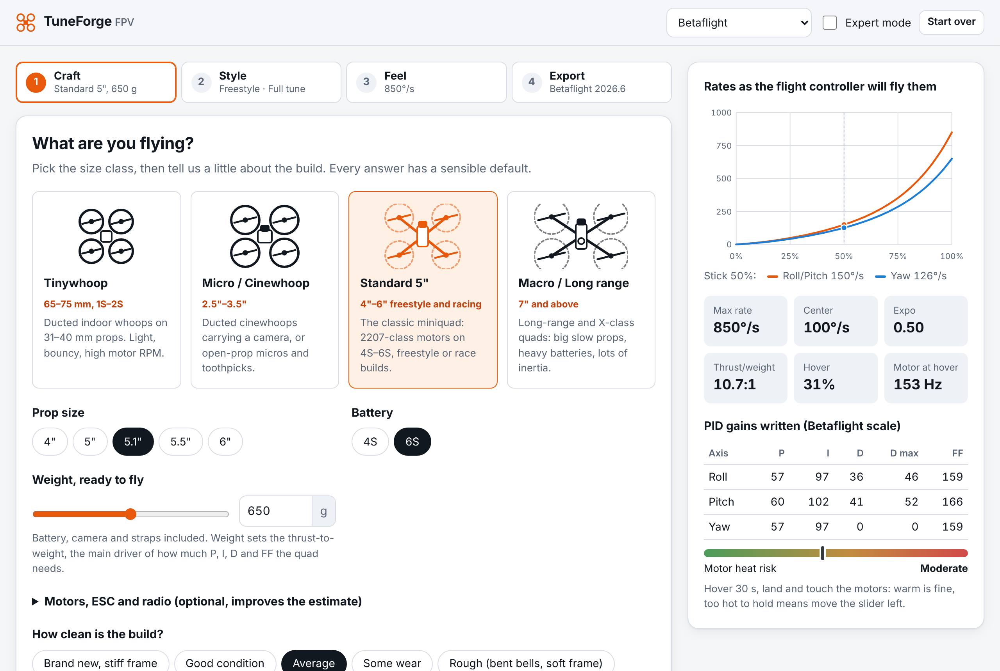
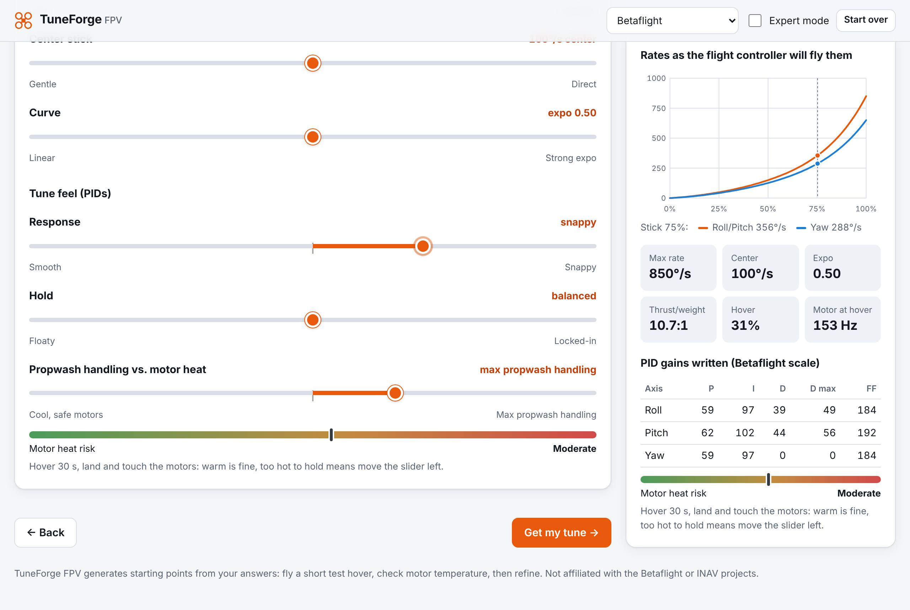
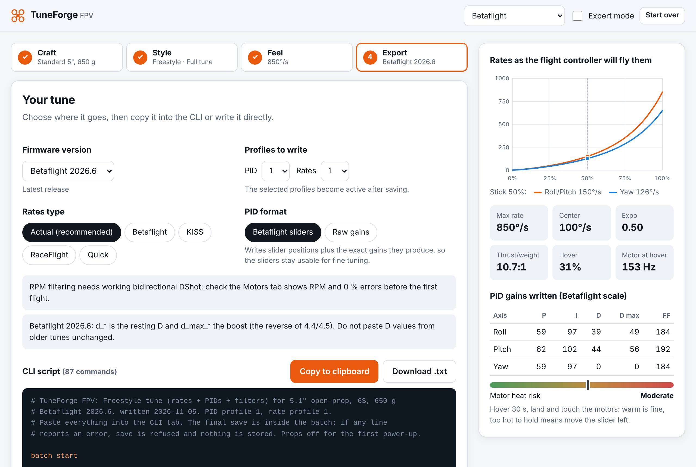
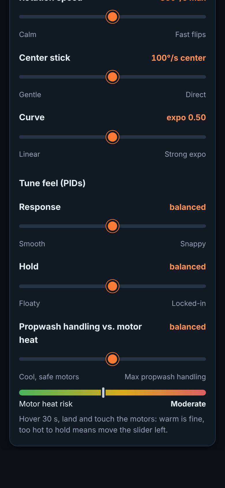

# TuneForge FPV

*(working title "UAV TuneMaster")*

Answer a few questions about your quad (size, weight, battery, how you fly) and get Betaflight
**rates, PIDs and filters** as a ready-to-paste CLI block, or write them straight to the flight
controller over USB. Sliders such as *Smooth ↔ Snappy* and *Cool motors ↔ Max propwash handling*
replace raw PID numbers; an expert mode shows and edits every parameter.

<p>
  
  
</p>
<p>
  
  
</p>

```bash
cd tuneforge
npm ci
npm run dev        # http://localhost:5173
npm run check      # lint, types, unit tests, production build
```

## What it does

- **Four size classes**: Tinywhoop (65–75 mm, 1S–2S), Micro / Cinewhoop (2.5"–3.5", ducted or open),
  Standard 5" (4"–6"), Macro / Long range (7"+). Prop size, cells, all-up weight, optional motor KV and
  pole count, ESC firmware (RPM filter or not), radio link rate and build condition.
- **Three flight styles**, each with its own rate curve and PID character: Freestyle (snappy flips),
  Cinematic (low center sensitivity, low expo, heavy feedforward smoothing), Racing (near-linear,
  strong feedforward and I for tracking).
- **Rates only, rates + matched PIDs, or a full tune.** In the hybrid modes the PID side follows the
  rates: D boost range, I-term relax cutoff and the feedforward max-rate limit change with the max rate.
- **Live preview**: rate curves exactly as the firmware will compute them from the stored integers,
  thrust-to-weight, hover throttle, the gains being written and a motor-heat meter.
- **Why these numbers?**: every scaling step comes with a sentence (and a factor).
- **Betaflight 4.4, 4.5, 2025.12 and 2026.6**, CLI validated per version; rates exported as Actual
  (default) or any other Betaflight rates type; PIDs as Betaflight sliders (default) or raw gains.
- **Import** a `diff all` to compare, reuse your current rates, motor poles and active profiles.
- **Direct write** over Web Serial (Chrome/Edge), a **simulated flight controller** to try the flow, and
  `tools/push_cli.py` (pyserial) for desktops without Web Serial.
- **INAV** adapter (experimental, rates only) proves the plugin layer; EmuFlight and KISS are stubs.

## Tech stack, and why

| Choice | Reason |
|---|---|
| **TypeScript, no UI dependency in the core** | The tuning math is a pure library: unit-tested in Node, reusable in a CLI, a Tauri/Electron shell or a mobile app. |
| **React 19 + Vite** | Fast, small static bundle (≈ 105 kB gzipped), deploys anywhere, the same stack as the rest of this repository. |
| **Web Serial** | Flight controllers enumerate as USB CDC virtual COM ports, so Web Serial (not WebUSB, which is for DFU flashing) is the right API; the Betaflight App itself is a web app on it. |
| **pyserial tool** | For Firefox/Safari users and scripting: same protocol, tested against a fake flight controller on a pseudo-terminal. |
| **Desktop later: Tauri** | Wrap the same build and implement `SerialTransport` with a Tauri serial plugin; no core changes. Python + PyQt was rejected: the tuning code would be locked to one platform and the UI could not run in a browser. |

## Architecture

```
tuneforge/
├─ src/
│  ├─ core/                     firmware-agnostic domain (no React, no DOM)
│  │  ├─ types.ts               CraftSpec, FlightStyle, FeelSliders, RateCurve …
│  │  ├─ craft/classes.ts       the four size classes, defaults, ranges
│  │  ├─ craft/physics.ts       thrust, thrust-to-weight, hover throttle, motor Hz
│  │  ├─ rates/models.ts        Betaflight ACTUAL/BETAFLIGHT/KISS/RACEFLIGHT/QUICK + INAV, ported from firmware
│  │  ├─ rates/fit.ts           curve → integer parameters of any model (and back)
│  │  ├─ rates/designer.ts      style rate curves, size scaling, rate-feel sliders
│  │  └─ tuning/
│  │     ├─ pid.ts              gains scaled by TWR, size, ducts, style, rates, sliders
│  │     ├─ dynamics.ts         feedforward, I-term relax, anti-gravity, TPA, dynamic idle …
│  │     ├─ filters.ts          gyro/D-term/notch/RPM filters by build noise, heat risk
│  │     └─ engine.ts           wizard answers → CanonicalTune
│  ├─ firmware/                 plugins: CanonicalTune → firmware parameters and CLI text
│  │  ├─ types.ts               FirmwareAdapter contract (compile, renderCli, parseDump, CLI dialect)
│  │  ├─ registry.ts            the list of adapters
│  │  ├─ betaflight/            versions.ts, schema/*.json (generated), compile.ts, simplified.ts,
│  │  │                         cli.ts, dump.ts
│  │  ├─ inav/                  experimental, rates only
│  │  └─ planned.ts             EmuFlight, KISS/Ultra
│  ├─ transport/                talking to a flight controller
│  │  ├─ types.ts               SerialTransport interface
│  │  ├─ webSerial.ts           browser implementation
│  │  ├─ cliSession.ts          enter CLI, send/await prompt, errors, version check, save
│  │  └─ simulatedFc.ts         a Betaflight CLI simulator (tests and demo)
│  └─ ui/                       React: App, wizard steps, panels, controls, state reducer
├─ scripts/extract-betaflight-schema.mjs   generates schema/bf-<version>.json from firmware source
├─ tools/push_cli.py            pyserial pusher (+ test_push_cli.py)
└─ docs/TUNING_MODEL.md         the model, its formulas and its calibration
```

Data flow: `wizard answers → core.generateTune() → CanonicalTune → adapter.compile() →
CompiledConfig (validated params) → adapter.renderCli() → script → copy / download / pushScript()`.

## Accuracy: what is checked against the firmware

- **Parameter names, scopes and ranges** come from the firmware source, not memory:
  `scripts/extract-betaflight-schema.mjs` parses each version's `cli/settings.c` (resolving the
  `#if` blocks of a multirotor build, lookup tables and constants) into `schema/bf-<version>.json`.
  Every generated value is validated against it; a test compiles 288 combinations (4 versions ×
  4 classes × 3 styles × 3 scopes × 2 PID formats) and requires zero issues.
- **Version differences are read from the schema**: in 4.4/4.5 `d_<axis>` is the boosted D and
  `d_min_<axis>` the resting D; from 2025.12 `d_<axis>` is the resting D and `d_max_<axis>` the boost.
  Also `simplified_dmax_gain` → `simplified_d_max_gain`. A 4.5 tune pasted unchanged into 2025.12
  would silently swap the meaning of D; TuneForge never does.
- **Rate formulas** are line-by-line ports of `fc/rc.c` (identical from 4.4 to 2026.6); tests pin the
  firmware defaults (ACTUAL 7/67/0 → 70 °/s center, 670 °/s max; classic 1.00/0.70 → 666.7 °/s).
- **Slider math** ports `config/simplified_tuning.c` for both D namings and reproduces a published
  UAV Tech preset exactly. In slider mode the script writes the slider positions *and* the exact gains
  the firmware computes from them; in raw mode it switches the sliders off, because the Betaflight App
  recalculates gains from enabled sliders when the PID tab is saved.
- **CLI semantics** from `cli/cli.c`: everything after `#` is ignored; `profile`/`rateprofile` are
  0-based; inside `batch start` an error sets a flag that makes `save` refuse, but `batch end` clears it,
  so the script ends with `save` *inside* the batch. One bad line, nothing stored.

## Writing to the flight controller

`Export → Write directly`: tick *Props are off*, connect, pick the port. `pushScript()` enters the
CLI, reads `version` and refuses to continue if the firmware is not the version the script was built
for, sends one command at a time, and on the first `###ERROR…###` sends `exit` (reboot without
saving). Only a clean run ends with `save`. *Try on a simulated flight controller* runs the same flow
against `SimulatedFlightController`.

Without Web Serial:

```bash
pip install pyserial
python tools/push_cli.py tuneforge-freestyle-betaflight-2026.6.txt --expect-version 2026.6
python tools/push_cli.py tune.txt --dry-run      # check every line, never save
```

## Extending

**A new Betaflight release**

```bash
git clone --depth=1 -b 2026.12-maintenance https://github.com/betaflight/betaflight /tmp/bf
node scripts/extract-betaflight-schema.mjs /tmp/bf 2026.12 --out src/firmware/betaflight/schema/bf-2026.12.json
```

Then import the JSON and add the version in `src/firmware/betaflight/versions.ts`. Renamed D-term,
slider and idle parameters are detected from the schema automatically; check the PID/filter
defaults in `flight/pid.h` and `sensors/gyro.h` in case the reference tune changed.

**A new firmware** implements `FirmwareAdapter` (`src/firmware/types.ts`): `compile()` maps the
canonical tune (rates as deg/s curves, gains in Betaflight scale, filters in Hz) to its parameters,
`renderCli()` writes its script, optionally `parseDump()`, `detectVersion()` and a `cli` dialect for
direct connection. Add it to `registry.ts`. The INAV adapter is a complete small example: it fits
INAV's rate model (shared roll/pitch expo, deg/s ÷ 10) and uses the 1-based `control_profile`.

## Safety

Generated tunes are starting points. Props off for the first power-up and the first write; check that
the Motors tab shows RPM with 0 % errors before relying on the RPM filter; hover for 30 seconds and
check motor temperature before flying hard.
